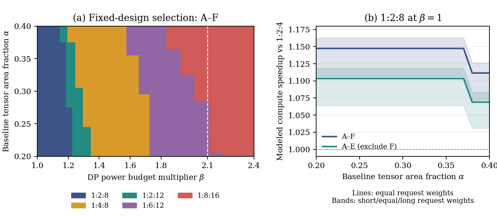

# DSE 复盘：从实测 DP 成本到跨精度迁移的固定配比选择

2026-11-17。独立分析报告，尚未修改中英文论文或图 5。结果是理想 GEMM 计算服务时间的解析估计，不是端到端推理实测。

**结论：现有模型可以形成完整 DSE，但必须补齐预算定义、算子计算量、迁移矩阵和跨场景目标函数。此次重新计算复现了图 5，并完成 2,961 个预算点、26,649 个部署配置、1,758,834 个“配置×场景×上下文”评估。最有说服力的发现是：等功耗下的适度 FP4 增配具有跨面积假设和负载权重的稳定性；放宽功耗后，最优配比沿可解释的部署阈值发生变化。**

## 1. 面积与功耗如何共同决定可部署核心数

九个候选均支持完整 BF16/MXFP8/MXFP4 工作负载。以 `1:2:4` 为基准，固定每核 DP 数 $D=256$、基准核数 $N_0=36$、频率 $f=1$ GHz、II=1。$a_j$ 是实测单 DP 面积；$p_{j,p}$ 是对应精度模式的实测总功耗。

以下用 H/Q/E 分别表示 BF16、FP8、FP4 计算族；配比按这三个计算族的峰值吞吐排列。$K_{j,p}$ 表示单 DP 在模式 $p$ 下每周期完成的乘加数，基准分别为 16/32/64。

$$r_j=a_j/a_0,\qquad p_j^{\max}=\max_p p_{j,p},\qquad \rho_j=p_j^{\max}/p_0^{\max}.$$

**α 是基准核心中 DP 阵列的面积占比，不是所有候选都保持不变的比例。** 在一个给定 α 下，各候选共用相同外围面积：

$$A_O=Da_0(\alpha^{-1}-1),\quad A_j=A_O+Da_j,\quad A_b=N_0Da_0/\alpha.$$

这里假设低精度增配不要求外围 shared memory、控制等面积同步增长，DP 面积之和作为阵列面积代理。由此得到一个更清楚的部署公式：

$$n_j(\alpha,\beta)=\min\left\{
\left\lfloor\frac{N_0}{1+\alpha(r_j-1)}\right\rfloor,
\left\lfloor\frac{\beta N_0}{\rho_j}\right\rfloor
\right\},\qquad P_b=\beta N_0Dp_0^{\max}.$$

第一个分母表示单核总面积的放大倍率；第二项限制所有安装核心在任一被测模式下同时运行。核心数取整数，安装后不随上下文或精度切换。两种模式的峰值不能相加。

在 α=0.30、β=1 下，面积预算为 **496.59 mm²**，DP 池功耗预算为 **147.47 W**。这不是整芯片 TDP：未计外围、互连和存储功耗；$p^{\max}$ 是三个负载驱动平均功耗的最大值，也不是电气最坏瞬时功耗。

**α 扫描的含义。** 主扫描固定基准 36 核，每个 α 重新校准共同面积预算；α=0.20/0.30/0.40 分别对应 744.89/496.59/372.44 mm²。它研究“外围占比假设是否影响结论”，不是在同一个固定 mm² 芯片上任意改变 α。若固定绝对面积与功耗，基准本身的核数也会变化，必须另列实验；附带的 [固定绝对预算检查](data/fixed_absolute_budget_check.csv) 已体现这一差异，不能与主扫描混合解释。

β=1 时，代表配置的“面积上限 / 联合约束部署数”如下；其余配置见完整 CSV。面积假设确实影响部署，但功耗受限配置表现为平台区。

| 配比 | α=0.20 | α=0.30 | α=0.40 |
|---|---:|---:|---:|
| 1:2:4 | 36 / 36 | 36 / 36 | 36 / 36 |
| 1:2:8 | 33 / 32 | 32 / 32 | 31 / 31 |
| 1:4:8 | 31 / 20 | 29 / 20 | 28 / 20 |
| 1:2:16 | 30 / 19 | 28 / 19 | 26 / 19 |
| 1:8:16 | 26 / 10 | 22 / 10 | 20 / 10 |

作为区别，若将绝对预算固定在 496.59 mm² / 147.47 W，α=0.20 时基准只能放入 24 核，A–F 均衡最优会变为 20 核 `1:4:8`（1.41×）。此时功耗预算相当于实际 24 核基准的 1.50 倍，已不是主扫描的“与可部署基准等功耗”。因此论文必须先说明固定的是基准规模、绝对预算还是实际基准功耗。

## 2. 从算子到六种精度迁移场景

工作负载沿用冻结的 DeepSeek-V4.1-Flash 配置与计算量代码：文本冷启动 prefill、batch=1、$L=2^{10},\ldots,2^{20}$。CED 包括 20 层 encoder 的全上下文计算、decoder 全局 KV 构建和最近 $\min(L,128)$ token 的 20 层 decoder replay，以及首 token 输出头。FP32 GEMM 单列，不进入三精度服务时间；视觉、后续 decode 和 DSpark 不在范围内。该 CED 组织与[官方说明](https://huggingface.co/deepseek-ai/DeepSeek-V4.1-Flash/blob/main/README.md)一致。

计算量不是手工给定的精度百分比，而由算子维度求和得到：

| 算子 | FLOP 计数，乘加按 2 FLOP |
|---|---|
| 稠密投影 | $F_o=2M_oN_oK_o\,R_o$，$R_o$ 为重复组数 |
| 路由专家 gate/up/down | 每个处理段 $6BL\,k_{\rm active}df$，其中激活专家数为 6，$d=5120,f=2304$ |
| 共享专家 gate/up/down | 每个处理段 $6BLdf$ |
| QK 与 PV | 每项 $2BHd_hU$；SWA 用 $U=\sum_t\min(t,128)$，CSA 主注意力用 $U=\sum_t\min(\lfloor t/r\rfloor,512)$ |
| 原生 FP4 索引器 QK | $2BH_id_iU_i$；Full 用压缩后全部可见位置，Reindex 用有上限的候选池 |

实际代码对 encoder、KV 构建、decoder replay 分段计算历史偏移与可见位置，避免将完整 40 层都按 $L$ 个 token 重算。完整算子账本见 [operator_work.csv](data/operator_work.csv)。

设 $\pi_s(o)$ 为场景 $s$ 对算子 $o$ 的精度选择，则

$$F_{s,p}(L)=\sum_o\mathbf1[\pi_s(o)=p]F_o(L),\qquad x_{s,p}(L)=\frac{F_{s,p}(L)}{\sum_{q\in\{H,Q,E\}}F_{s,q}(L)}.$$

六场景只迁移五类主要计算，算子形状和总 FLOP 不变：

| 场景/用途 | 路由专家 | 共享专家、Q-up/O-up | 主 SWA/CSA QK+PV、Grouped O-down |
|---|---|---|---|
| A：参考执行映射 | FP8 | FP8 | BF16 |
| B：专家 W4A4 路线 | FP4 | FP8 | BF16 |
| C：扩大线性层 FP4 范围 | FP4 | FP4 | BF16 |
| D：B 上推进注意力 FP8 | FP4 | FP8 | FP8 |
| E：合并 C/D | FP4 | FP4 | FP8 |
| F：核心计算进一步 FP4 化 | FP4 | FP4 | FP4 |

路径是 **A→B，B→C 或 D，C/D→E→F**，不是六个无条件连续版本。原生 FP4 索引计算始终保留；Q-down、SWA-KV、Index-Q 等背景投影不迁移；router 的 FP32 控制计算也不迁移。F 仍有背景 BF16/FP8 工作量，并非全模型 FP4。

合理性分层：A 的专家 FP4 权重仍使用 FP8 激活参与混合精度 GEMM，不能因为权重四位就归入 FP4×FP4 峰值；[官方 linear 实现](https://huggingface.co/deepseek-ai/DeepSeek-V4.1-Flash/blob/main/inference/model.py)明确采用这一接口。B 的 routed-expert W4A4 路线已有 [NVIDIA 模型卡](https://huggingface.co/nvidia/DeepSeek-V4.1-Flash-NVFP4)支持。C 是对共享专家及主要投影继续量化的条件假设；D 的注意力迁移参考 [FlashAttention-3](https://arxiv.org/abs/2407.08608)，Grouped O-down 的迁移另属本研究假设；F 参考 [SageAttention3](https://arxiv.org/html/2505.11594v3) 的 FP4 注意力机制，但不据此声称完整 V4.1 的精度质量已验证。

原始 A 场景的 H/Q/E 计算量占比从 **1K：14.08%/85.86%/0.06%** 变化到 **1M：12.24%/60.49%/27.27%**。长上下文增长的 FP4 工作量主要来自 Full indexer QK，而不是把有窗口/TopK 上限的主注意力简单按 $L^2$ 放大。迁移的五类计算在 1K/1M 分别覆盖全部 GEMM 的 93.28%/67.92%；其余部分中最大的长上下文项正是保留原生 FP4 的索引器。

## 3. 部署和负载如何合成图 5 的分数

模式峰值与单请求计算时间为

$$C_{j,p}=2fDn_jK_{j,p},\qquad
\widehat T_{j,s,L}=\sum_{p\in\{H,Q,E\}}\frac{F_{s,p}(L)}{\eta_{j,p,s,L}C_{j,p}}.$$

本轮沿用 $\eta=1$，不同算子/模式的服务时间相加；不模拟同时达到各模式峰值。这里估计的是主要 GEMM 的理想计算时间，未计访存、路由通信和格式转换。FP8/FP4 族采用已测 MXFP8 E4M3/MXFP4 E2M1 的功耗代理，不等于各缩放格式已分别测量。

例如 α=0.30、β=1、场景 B、64K：H/Q/E 工作量为 **189.27/380.68/584.24 TFLOP**。`1:2:4` 部署 36 核，三精度峰值为 294.91/589.82/1179.65 TFLOP/s，估计时间 **1.78 s**；`1:2:8` 部署 32 核，对应 262.14/524.29/2097.15 TFLOP/s，时间 **1.73 s**，同请求加速 **1.03×**。这说明 FP4 峰值增长并不等价于全负载同比加速。

图 5 当前采用同场景的平均时间之比，All 列同时汇总六场景：

$$\bar T_j=\sum_s v_s\sum_Lw_L\widehat T_{j,s,L},\quad
S_j=\bar T_0/\bar T_j,\quad j^*=\arg\min_j\bar T_j.$$

当前 $v_s=1/6,w_L=1/11$。固定一款芯片后汇总 66 个请求，不能先为每个请求选择最优芯片再求均值。本轮逐算子重算并核对了原图 5 全部 63 个单元格，见 [逐请求复算](data/figure5_reproduction.csv)。

**均衡请求概率不等于均衡性能影响。** 令 $r_{j,s,L}=T_j/T_0$，则 $S_j^{-1}=\sum\widetilde w_{s,L}r_{j,s,L}$，其中 $\widetilde w\propto v_sw_LT_{0,s,L}$。因此原 All 指标中 1M 请求贡献 **53.41%** 的有效权重，512K+1M 合计 **77.56%**。这是平均服务时间目标的数学结果，不能称为每个上下文对最终收益贡献相同。

为避免只依赖一种评分，本轮另报告：按相同请求概率加权的归一化时间分数 $S_j^{\rm norm}=1/\sum v_sw_L(T_j/T_0)$；几何平均加速 $G_j=\exp[\sum v_sw_L\log(T_0/T_j)]$；最坏相对损失 $R_j=\max_{s,L}(T_j/\min_kT_k-1)$。主指标 $S_j$ 用于固定部署的平均服务时间选择，三个补充指标用于检验跨场景稳定性，不人为合成一个带任意权重的总分。

## 4. α/β 扫描范围和结果

主敏感性区间：**α=0.20–0.40、β=1.00–2.10，步长均为 0.01**；β 补充扫描至 2.40。上下文分布采用 $w_L\propto L^{-1},1,L$，分别作为短上下文偏重、对数采样等概率和长上下文偏重的敏感性假设。它们不是实测业务请求分布。

α=0.30 的量级参照来自 [Huawei Research 第 6 期 §6.1](https://www-file.huawei.com/-/media/corp2020/pdf/publications/huawei-research/2024/huawei-research-issue6-en.pdf#page=99)：其中 Cube computing clusters 占 AI Core 面积的 32.7%。该划分并不等同于本文 DP 阵列边界，因此采用 0.20–0.40 检查假设敏感性，不把 30% 当作已测的本设计面积比例。β=1 是相同 DP 功耗预算的主比较点；β>1 用于揭示新增供电预算如何改变部署与选型。

β 上界由“面积允许的核心数能否全部部署”决定，而非任意选取：

$$\beta_j^{\rm sat}(\alpha)=\frac{n_j^A(\alpha)\rho_j}{N_0},\quad
\beta^{\rm sat}(\alpha)=\max_j\beta_j^{\rm sat}(\alpha).$$

| α | `1:8:16` 面积上限核数 | 全九配比达到面积上限的 β |
|---|---:|---:|
| 0.20 | 26 | 2.39 |
| 0.30 | 22 | 2.02 |
| 0.40 | 20 | 1.83 |

所以 β=2.10 在 α=0.30 足够，在 α=0.20 尚不足；2.40 是整个 α 区间的补充饱和检查。α 改变部署数，但当功耗约束先起作用时，面积变化不会立刻改变已部署核数。



左图是 A–F、等请求权重下的最优固定配比；虚线标记 β=2.10。右图保留 β=1，实线为等请求权重，阴影为三种上下文分布范围。矢量版本：[dse_sensitivity.pdf](dse_sensitivity.pdf)。

### 发现一：等功耗下，适度 FP4 增配的优势不依赖 α=0.30 这一单点

在 **21 个 α 点×3 种上下文分布×A–F/A–E 两种场景集合×3 种均值评分** 的 378 项检查中，β=1 均选择 `1:2:8`。A–F 的平均时间加速为 **1.07–1.16×**；去除最激进 F 后为 **1.03–1.12×**。这是采样范围内的稳定性结果，不能推广为所有实际请求分布都最优。

α=0.30 下，原图 All 为 **1.15×（14.73%）**，归一化时间分数为 **1.15×（15.27%）**，几何平均为 **1.17×（17.22%）**；剔除 F 后原指标仍为 **1.10×（10.34%）**。`1:2:8` 在 A–F 的最坏相对损失为 **12.49%**，也在九配置中达到最小，因而其平均收益并非靠极端牺牲某一个场景获得。

但仅考虑近期 A/B，等概率平均时间最优变为 `1:2:6`（**1.02×（1.65%）**）；短上下文偏重时为原基线。**设计推荐应明确面向广泛迁移路线，而不是声称对当前模型普遍更优。**

### 发现二：预算改变最优配比的路线，可由部署阈值解释

α=0.30、A–F 等权时，在本轮 0.01 β 网格上，最优配比依次为：

| β 区间（已采样点） | 最优配比 |
|---|---|
| 1.00–1.18 | 1:2:8 |
| 1.19–1.29 | 1:2:12 |
| 1.30–1.65 | 1:4:8 |
| 1.66–2.01 | 1:6:12 |
| 2.02–2.40 | 1:8:16 |

例如 β=1.50 时，α=0.20/0.30/0.40 均选择 `1:4:8`，加速分别为 **1.41/1.36/1.31×**。α=0.30 的 `1:8:16` 达到 22 核需要 β 约为 2.02；在此之后继续增加 β 不提高其理想峰值。**功耗放宽后的方向并不是始终只堆 FP4：残余 FP8 工作量使均衡增配重新占优。**

### 发现三：相同 FP4 容量的优劣取决于“剩余精度工作量×可部署数量”

α=0.30、β=1 时，`1:2:8`/`1:4:8` 分别部署 **32/20 核**；虽单 DP FP4 吞吐相同，前者芯片 FP4 峰值高 **60%**。将各精度服务时间展开，可得到两者的明确胜负条件：

$$\widehat T_{1:2:8}\le\widehat T_{1:4:8}
\iff F_Q\le6F_H+0.75F_E.$$

这把“面积/功耗约束”和“精度迁移”直接联系起来：迁移减少 $F_H$ 的同时，转向 FP8 还是 FP4 会以不同方向改变边界；上下文增长又改变索引器带来的 $F_E$。该式只对应当前 32/20 核条件，扫描其他 α/β 时应使用各自部署数重算，不能当作全局固定阈值。

## 5. 下一版论文建议与需作者确认事项

建议第五章按 **联合部署公式 → 六场景与工作量公式 → 固定设计评分 → 参数扫描及两条发现** 组织。正文重点保留发现一和二，发现三可用一句解释或边界公式加强机理。图 5 可由当前单预算结果图升级为本报告的预算选型图与稳定性图；原九配比逐场景收益矩阵留作补充材料，尚未替换正式图。

需明确的边界集中列在这里，避免在论文结果段落反复插入保留性表述：

- *若要求整芯片等总功耗，需要外围功耗模型。可引入基准 DP 功耗占比 γ，将功耗核数写为 $\lfloor\beta_{\rm chip}N_0/[1+\gamma(\rho_j-1)]\rfloor$（固定每核外围功耗假设）。当前没有 γ 的实测依据，不将 DP 池预算改称整芯片 TDP。*
- *A–F 是硬件负载情景，C–F 的完整模型质量、Grouped O-down 等非注意力算子量化容忍度仍需作者确认；本报告不新增模型准确率结果。*
- *阵列完全利用、充分供数和固定外围面积为模型前提。实验功耗来自 Qwen3-8B 数据驱动 DP 测量，并非 DeepSeek 每种 GEMM 的真实切换活动。*
- *本地配置来源记录指向 revision `314113f…`，计算量模块另有 `SOURCE_REVISION=dba1be…` 常量；本轮按配置 SHA 与冻结 FLOP 账本复算一致，但这两个来源标记应在论文定稿前统一。未据最新网页自动更新模型版本。*

## 6. 可复现入口

```bash
PYTHONDONTWRITEBYTECODE=1 python3 scripts/audit_dse_sensitivity.py --output reports/dse_review_20261117/data
MPLCONFIGDIR=/tmp/dp_dse_mpl PYTHONDONTWRITEBYTECODE=1 python3 scripts/plot_dse_review.py --directory reports/dse_review_20261117
```

输入固定为九种完整精度 DP 的已保存面积/功耗、`data/inputs/v41_core.json` 和模型配置。此次更新过的 `0:2:4` 不支持完整三精度负载，因此不混入九配比 DSE。输出包含 [预算赢家](data/budget_winners.csv)、[部署数量和绝对峰值](data/hardware_grid.csv)、[代表点各候选评分](data/selected_metrics.csv)、[有效上下文权重](data/effective_weights.csv)、[饱和阈值](data/beta_saturation.csv) 及完整压缩评分网格。硬件模型 8 项、场景映射 6 项既有测试通过；脚本内另验证 FLOP 守恒、冻结输入、简化部署公式、图 5 精确复算与基准恒等性。分析状态为 `analytical_uncalibrated`，原始综合/功耗数据没有重新测量。
